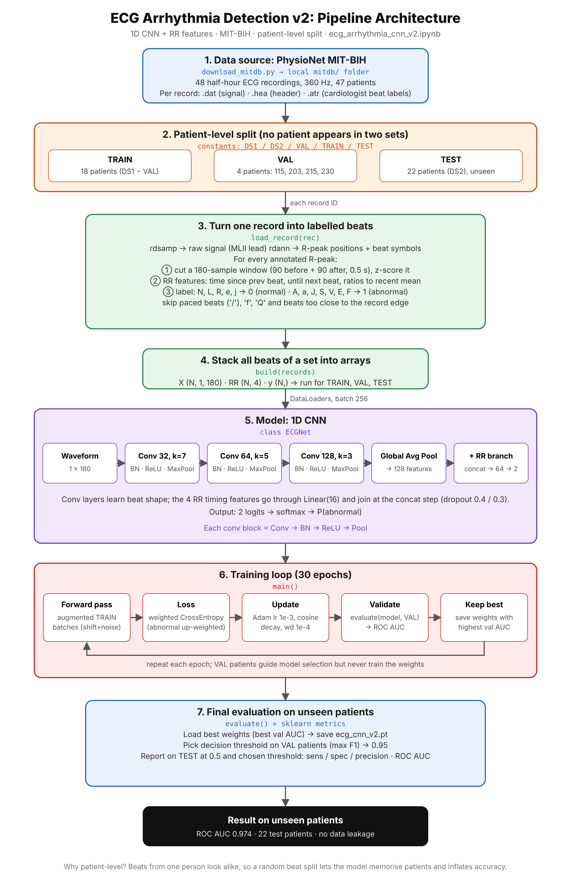
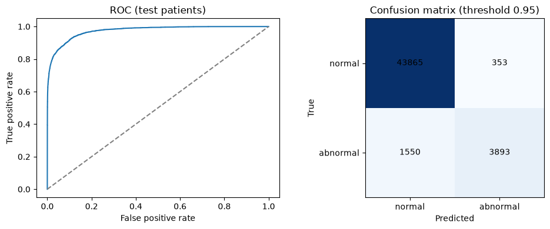
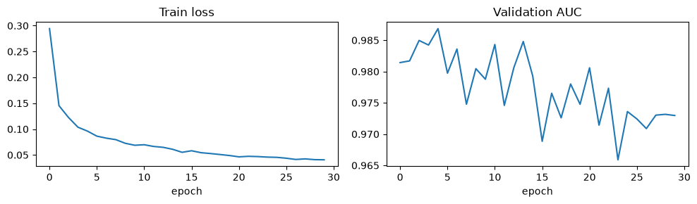

# Heart Arrhythmia Detection from ECG Signals

A 1D CNN (PyTorch) that classifies individual heartbeats from the **MIT-BIH Arrhythmia Database** as **normal** or **abnormal**.

The data is split **by patient, not by heartbeat**. Mixing beats from the same person into both training and testing lets a model "recognise the patient" instead of the arrhythmia, which inflates most results you see online. Here the model is tested only on patients it has never seen.

The model combines two things: the **waveform** of each beat (1D CNN) and **RR-interval timing features** (how early or late the beat arrived relative to its neighbours).



## Results

Evaluated on **22 unseen test patients (about 49,660 beats, about 11% abnormal)**:

| Model | ROC AUC |
|---|---|
| v1: waveform only | 0.887 |
| **v2: waveform + RR features (this repo)** | **0.974** |

v2 at two operating points (the 0.95 threshold was chosen on the validation patients, never on the test set):

| Threshold | Sensitivity | Specificity | Precision | F1 (abnormal) |
|---|---|---|---|---|
| 0.50 | 89.8% | 91.7% | 57.1% | 0.698 |
| 0.95 | 71.5% | 99.2% | 91.7% | 0.804 |

A lower threshold catches more abnormal beats at the cost of more false alarms; a higher one does the reverse.

| ROC curve and confusion matrix | Training curves |
|---|---|
|  |  |

## Project structure

```
ecg-arrhythmia-cnn/
├── ecg_arrhythmia_cnn_v2.ipynb   # the full pipeline: data → model → training → evaluation
├── download_mitdb.py             # one-time fast data download
├── requirements.txt
├── results/                      # plots used in this README
└── mitdb/                        # created by the download script (not committed)
```

## How to run

### 1. Set up the environment

Requires Python 3.9 or newer. In a terminal (PowerShell on Windows) inside the project folder:

```powershell
python -m venv venv
venv\Scripts\activate          # macOS/Linux: source venv/bin/activate
pip install -r requirements.txt
```

If PowerShell blocks the activate script, run
`Set-ExecutionPolicy -Scope Process -ExecutionPolicy RemoteSigned` first.

### 2. Get the data (one time, about 100 MB)

```powershell
python download_mitdb.py mitdb
```

This downloads the 44 records the project uses (about 130 small files) in parallel from PhysioNet's public S3 mirror. It retries failed files and skips files you already have, so you can re-run it if it is interrupted. It prints `All files present.` when done.

Alternative: download the ZIP from https://physionet.org/content/mitdb/get-zip/1.0.0/ (can be slow), unzip it into a folder named `mitdb`, and make sure it contains files like `100.dat`, `100.hea` and `100.atr`.

If your data folder has a different name or location, change `DATA_DIR` in the notebook's config cell. The notebook searches that folder recursively, so a nested unzip folder is fine.

### 3. Run the notebook

```powershell
jupyter notebook ecg_arrhythmia_cnn_v2.ipynb
```

Or open it in VS Code and choose your `venv` as the kernel. Then **Run All**.

Training takes roughly 10–30 minutes on a CPU, depending on your machine. It runs 30 epochs and saves the best weights to `ecg_cnn_v2.pt`. A GPU is used automatically if available.

Results vary slightly between runs and machines. The notebook sets random seeds, but exact reproducibility is not guaranteed across hardware.

## How it works

1. **Data:** MIT-BIH has 48 half-hour two-lead ECG recordings from 47 patients at 360 Hz, with every beat labelled by cardiologists. This project uses 44 records and the MLII lead, excluding the 4 paced records (102, 104, 107, 217).
2. **Patient-level split:** the standard inter-patient split of de Chazal et al. (2004). Training is 18 patients, validation is 4 (records 115, 203, 215, 230) and testing is the 22 patients of DS2. No patient appears in more than one set.
3. **Beat extraction:** a 180-sample window (0.5 s) around each annotated R-peak, normalised per beat (z-score).
4. **Labels:** N, L, R, e, j = normal; A, a, J, S, V, E, F = abnormal. Paced and unclassifiable beats are skipped.
5. **RR features:** time since the previous beat, time until the next beat, and each as a ratio to the recent average. Standardised with training statistics only.
6. **Model:** three Conv1D blocks (32, 64, 128 filters; kernels 7, 5, 3) with BatchNorm, ReLU and MaxPool, then global average pooling. A small branch encodes the RR features. Both are concatenated and passed through a 64-unit layer to a 2-class output.
7. **Training:** class-weighted cross-entropy for the imbalance, Adam (lr 1e-3, weight decay 1e-4) with cosine learning-rate decay, random time-shift and noise augmentation, and the best epoch chosen by validation ROC AUC.
8. **Threshold:** the decision threshold is chosen on the validation patients (maximising F1 of the abnormal class). Test results are reported at 0.5 and at that threshold.

## Limitations

- One ECG lead and one train/test split, with no confidence intervals.
- Metrics are per beat, not per patient or per recording.
- Binary classification: it does not distinguish arrhythmia types.
- Only 4 validation patients, so validation metrics are noisy; the chosen threshold (0.95) sits at the edge of the search range.
- Per-beat normalisation removes absolute amplitude information.
- This is an educational and portfolio project, not a medical device.

## Possible next steps

Cross-validation across patients, per-class results (AAMI classes), a simple baseline (e.g. random forest) for comparison, a second lead, and an interactive demo.

## Data and references

- Moody GB, Mark RG. *The impact of the MIT-BIH Arrhythmia Database.* IEEE Eng Med Biol 20(3):45–50 (2001).
- Goldberger A, et al. *PhysioBank, PhysioToolkit, and PhysioNet.* Circulation 101(23):e215–e220 (2000).
- de Chazal P, O'Dwyer M, Reilly RB. *Automatic classification of heartbeats using ECG morphology and heartbeat interval features.* IEEE Trans Biomed Eng 51(7):1196–1206 (2004).
- Dataset: https://physionet.org/content/mitdb/1.0.0/
